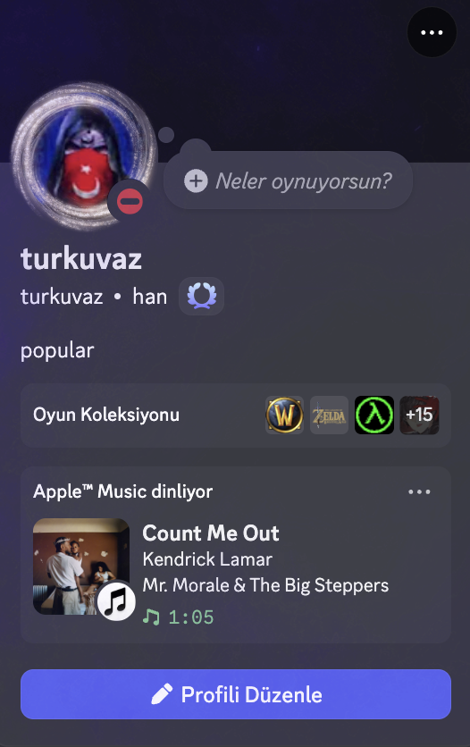

# Apple Music RPS

Discord Rich Presence for Apple Music on macOS. Shows the currently playing track with album artwork, artist, and elapsed time.



## Features

- Album artwork via iTunes API
- Elapsed time counter
- App icon badge (small image)
- Lives in the menu bar — no Dock icon

## Requirements

- macOS 13+
- Discord desktop app
- Go 1.21+ (to build the IPC bridge)
- Swift 5.9+ / Xcode 15+

## Setup

### 1. Create a Discord Application

1. Go to [discord.com/developers/applications](https://discord.com/developers/applications) and create a new application named **Apple™ Music** (or anything you like)
2. Copy the **Application ID** and paste it into `discord-rpc-go/main.go` as `clientID`
3. Under **Rich Presence → Art Assets**, upload your app icon and name it `appicon`
4. Under **Rich Presence → Art Assets**, copy the asset ID and update the `small_image` URL in `discord-rpc-go/main.go`:
   ```
   https://cdn.discordapp.com/app-assets/{YOUR_CLIENT_ID}/{ASSET_ID}.png
   ```

### 2. Build

```bash
make
```

This builds the Go IPC bridge, the Swift app bundle, and code-signs it ad-hoc.

### 3. Run

```bash
make run
```

Or double-click `AppMusicRPS.app`.

On first launch, macOS will ask for **Automation** permission to control Apple Music — click Allow.

## Project Structure

```
AppMusicRPS/          Swift app (menu bar, Apple Music bridge, Discord bridge)
discord-rpc-go/       Go binary that speaks the Discord IPC protocol
Makefile              Build + bundle script
```

## How It Works

1. A Swift timer polls Apple Music every 2 seconds via AppleScript
2. On track change, it sends a JSON line to the Go binary via stdin
3. The Go binary connects to Discord's local IPC socket and calls `SET_ACTIVITY`
4. Album artwork is fetched from the iTunes Search API by track + artist name
